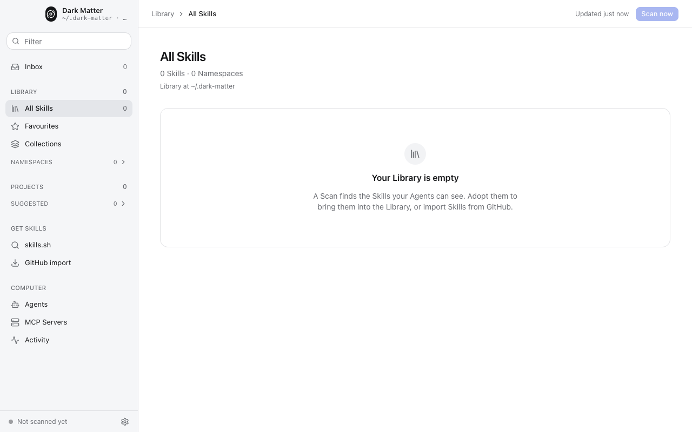

<div align="center">

# Dark Matter

**One place to manage every Agent Skill and MCP Server on your computer, and to decide which ones each project's coding agents actually load.**

[](https://github.com/cypherkunp/dark-matter/actions/workflows/ci.yml)


<picture>
  <source media="(prefers-color-scheme: dark)" srcset="docs/images/app-dark.png">
  
</picture>

<sub>The app today (a real screenshot, not a mock-up): the shell, navigation and empty Library. Scanning, adopting and importing are next.</sub>

</div>

---

> [!NOTE]
> **Dark Matter is pre-alpha.** The foundation is in place and runs end to end (desktop app, headless core, typed RPC, tests, CI), but the features below under [Roadmap](#roadmap) are not built yet. The design is public and settled enough to critique. [Feedback and ideas are very welcome](https://github.com/cypherkunp/dark-matter/issues).

## The problem

Coding agents such as Claude Code, Cursor, Codex and OpenCode all load **Skills** (`SKILL.md` folders) and **MCP Servers**, and each one keeps them in its own place. Over a few months you end up with:

- the same Skill copied into five agent folders, with five slightly different versions,
- dozens of Skills and MCP servers in global folders that **every** project inherits, whether it needs them or not,
- MCP tool definitions quietly eating context in sessions that never use them,
- API tokens pasted into JSON config files,
- no idea what any agent can see in a given repo, and no clean way to share a setup with a teammate.

Every Skill and server an agent loads costs context. Most of what is loaded is invisible, and most of it isn't needed. That is the dark matter.

## The idea

Dark Matter keeps **one Library** of Skills and MCP Servers at `~/.dark-matter`, and delivers to each **Project** only the ones you choose, for only the Agents you choose.

- **No global Skills, no global MCP Servers.** Dark Matter never writes to an agent's global folder or config. An agent sees what its project asks for and nothing else. ([ADR-0002](docs/adr/0002-no-global-skills.md))
- **Link or Copy.** A _Link_ is a personal symlink to the Library, kept out of git. A _Copy_ is real files, committed and recorded in `skills-lock.json`, so teammates get it without needing Dark Matter.
- **Personal or Shared MCP Servers.** _Personal_ servers hold your real secrets and are never committed. _Shared_ servers are written into the project's committed config with secrets as environment-variable references only.
- **Secrets live in the OS keychain.** Library definitions refer to a secret by name and never hold the value.
- **On / Off per project.** Turn a Skill or server off for a project without losing it.
- **Files are the source of truth.** Everything Dark Matter owns is small, readable JSON under `~/.dark-matter`. SQLite is only a disposable cache: delete it and nothing is lost. ([ADR-0005](docs/adr/0005-files-are-truth-sqlite-is-cache.md))

## Planned features

|                              |                                                                                                                                                                                                                                           |
| ---------------------------- | ----------------------------------------------------------------------------------------------------------------------------------------------------------------------------------------------------------------------------------------- |
| **Scan**                     | A read-only sweep that shows every Skill and MCP Server each supported agent can currently see, on the whole machine.                                                                                                                     |
| **Adopt**                    | Move what a Scan finds in global folders into the Library, with the original location recorded so it can be undone.                                                                                                                       |
| **Import**                   | Pull Skills from a GitHub repo or a [skills.sh](https://skills.sh) listing, pinned to an exact commit, with update checks.                                                                                                                |
| **Per-project control**      | Add, Link, Copy and toggle Skills and MCP Servers per Project and per Agent.                                                                                                                                                              |
| **Collections & Favourites** | Add a whole starter set to a project in one action.                                                                                                                                                                                       |
| **Inbox & Scheduled Scan**   | Everything awaiting your decision in one place, with a daily scan that flags new global Skills.                                                                                                                                           |
| **Activity Log**             | Every change, scan and failure, and which client asked for it.                                                                                                                                                                            |
| **Agent control**            | Let an agent manage its own project's Skills through a consent-gated MCP server and `dm` CLI. You approve each plan, or grant low-risk changes per project. ([ADR-0006](docs/adr/0006-agent-control-one-surface-consent-as-guardrail.md)) |

Supported agents in v1: **Claude Code, Cursor, OpenCode, Codex** and the generic **`.agents`** convention.

## Roadmap

- [x] Walking skeleton: Electron app, headless core and typed RPC working end to end
- [x] Single-writer core with lockfile, supervised restarts, and an authenticated loopback WebSocket
- [x] App shell with the full navigation, light and dark themes
- [x] CI on macOS and Linux: lint, typecheck, unused-code check, unit tests, build and an end-to-end smoke test
- [ ] Scan and the Inbox
- [ ] Adopt, with undo
- [ ] Projects, Project Skills (Link / Copy) and On / Off
- [ ] MCP Servers, with secrets in the keychain
- [ ] Import from GitHub and skills.sh
- [ ] Collections, Favourites, Scheduled Scan, Activity Log
- [ ] `dm` CLI and the MCP shim for agent control

Follow along or pick something up in [Issues](https://github.com/cypherkunp/dark-matter/issues).

## How it's built

Dark Matter is a **headless Node core** with an **Electron app** as one client of it. The core is the only process that writes anything, so the app, a future CLI and agents never race each other.

```
┌────────────────────┐   typed RPC (tRPC)      ┌─────────────────────────────┐
│ Electron renderer  │ ◄─────────────────────► │ Headless core (pure Node)   │
│ React · TanStack   │  loopback WebSocket,    │ single writer, owns the     │
│ Tailwind · shadcn  │  per-run token          │ Library, scans, watchers    │
└────────────────────┘                         └──────────────┬──────────────┘
   future: `dm` CLI,  ─────────────────────────────────────►  │
   stdio MCP shim for agents                                  ▼
                                          ~/.dark-matter  (JSON files)  +  SQLite cache
```

| Package                                    | Role                                                        |
| ------------------------------------------ | ----------------------------------------------------------- |
| [`packages/contracts`](packages/contracts) | Zod schemas and the tRPC router type shared by every client |
| [`packages/core`](packages/core)           | The headless core, pure Node with no Electron imports       |
| [`packages/desktop`](packages/desktop)     | Electron main, preload and the React renderer               |

Stack: TypeScript, Electron, React 19, TanStack Router and Query, Tailwind CSS 4, shadcn/ui on Base UI, Zod 4, tRPC 11 and `node:sqlite` with no ORM, tested with Vitest and Playwright, and linted with Biome and knip.

The reasoning behind each choice is written down as ADRs in [`docs/adr`](docs/adr), and the shared vocabulary (Library, Adopt, Link, Grant and so on) is defined in [`GLOSSARY.md`](GLOSSARY.md).

## Getting started

You need **Node.js 24** (see [`.nvmrc`](.nvmrc)) and **pnpm 12.21 or newer**.

```sh
git clone https://github.com/cypherkunp/dark-matter.git
cd dark-matter
pnpm install
pnpm dev        # builds the core, then launches the desktop app
```

Checks (the same ones CI runs):

```sh
pnpm lint       # Biome
pnpm typecheck  # tsc -b
pnpm knip       # unused code and dependencies
pnpm test       # Vitest
pnpm build && pnpm test:e2e   # builds, then drives the real app with Playwright
```

## Contributing

Contributions are welcome, especially while the architecture is still taking shape.

1. Read the [`GLOSSARY.md`](GLOSSARY.md) first. Using the same words as the code and the docs makes everything easier.
2. Skim the [ADRs](docs/adr) to see what has already been decided and why.
3. Open or comment on an [issue](https://github.com/cypherkunp/dark-matter/issues) before starting anything large.
4. Use [Conventional Commits](https://www.conventionalcommits.org/) (`feat(core): …`, `fix: …`, `docs: …`).
5. Make sure `pnpm lint`, `pnpm typecheck`, `pnpm knip` and `pnpm test` pass.

If Dark Matter solves a problem you have, a ⭐ helps other people find it. Telling us which agents and workflows you want supported first helps more.

## Security

Please report vulnerabilities privately as described in [SECURITY.md](SECURITY.md).

## License

[MIT License](LICENSE) © [Devvrat](https://devvrat.cc)
