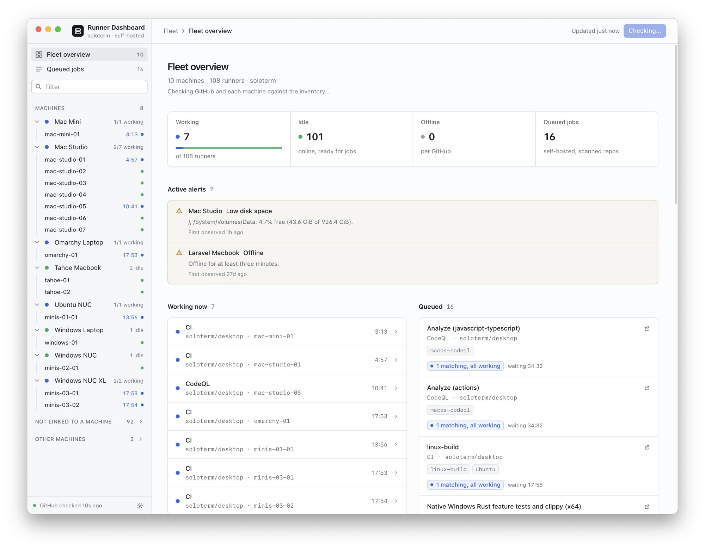

# Visual reference

`visual-reference.png` is the **visual language** reference for Dark Matter v1. It's a screenshot of another product, a self-hosted CI runner dashboard. Take the **look and density** from it, not its content, branding or layout one to one. The screens and navigation come from the [App information architecture and core screens](https://github.com/cypherkunp/dark-matter/issues/15) decision.

## What to take

- **A native macOS shell.** The window has inset traffic lights, and a light, slightly tinted sidebar sits next to a white content pane separated by a hairline. The app's mark and name sit at the top of the sidebar with a muted subtitle (`soloterm · self-hosted` becomes e.g. `~/.dark-matter · 214 Skills`).
- **A sidebar tree with counts and status dots.** Uppercase muted section headers carry a count on the right (`MACHINES 8` becomes `PROJECTS 6`). Rows can expand to show children. Every row has a right-aligned status: a short text summary for groups (`2/7 working` becomes `3 Skills · 1 outdated`) and a coloured dot for leaves. A filter field sits above the tree, and collapsed groups at the bottom have a count and a chevron (`NOT LINKED TO A MACHINE 92` becomes `Suggested 4`).
- **The sidebar footer shows how fresh the data is:** a dot plus "GitHub checked 10s ago" becomes "Scanned 10s ago · next 09:00", with the Settings gear on the right.
- **The header is a breadcrumb** (`Fleet › Fleet overview` becomes `Library › shadcn-ui/ui`). On the right sit a muted "Updated just now" and one primary action button that shows a busy state ("Checking…" becomes "Scanning…").
- **The page head** is a large semibold title, a muted one-line summary with `·` separators, and a muted status line underneath.
- **A row of stat cards:** a single bordered strip split into equal cells. Each cell has a label, a large number with a status dot, an optional thin progress bar, and a muted caption. Candidates: Project Skills On, Global Skills found, Outdated, Name Conflicts.
- **An alerts panel:** one warm-tinted (amber) bordered panel with stacked items. Each item has a ⚠ icon, a **bold subject plus the issue** ("Mac Studio Low disk space" becomes "~/.claude/skills 12 Global Skills found"), a detail line, and a muted "First observed 1h ago". This is how the Inbox and drift findings should surface on overview screens.
- **Two-column lists:** a section title with a muted count, then bordered cards of rows. Each row has a status dot, a title, a **monospace** secondary line for identifiers (`soloterm/desktop · mac-mini-01` becomes `shadcn-ui/ui · .agents/skills`), and a right-aligned value with a chevron or an external-link icon.
- **Monospace pills** for identifiers and labels (`macos-codeql` becomes Namespaces, Agent folders and `Link`/`Copy`). **Tinted pills** for state (blue "1 matching, all working" becomes "Link · On", "outdated" and so on), next to muted meta text ("waiting 34:32" becomes "commit a1b2c3d").

## Tokens to carry into the shadcn theme

- **Status colours:** blue = active/working (On, in use), green = healthy/idle (up to date), grey = offline/unknown (Off), amber = warning (alerts, Global Skills, outdated). Red is only for destructive confirmations.
- **Neutral surfaces** with hairline borders and generous radius (about 10–12 px on cards), and almost no shadows inside the window.
- **Type:** the system UI font (SF Pro) for text, and a monospace font for paths, Namespaces, commits and folder names. Numbers in stat cards are large and use tabular figures.
- **Density:** compact sidebar rows (about 32 px) and roomier content rows (about 64–80 px, two lines).
- Must work in dark mode as well. The reference is light only, so derive dark from the same tokens.
